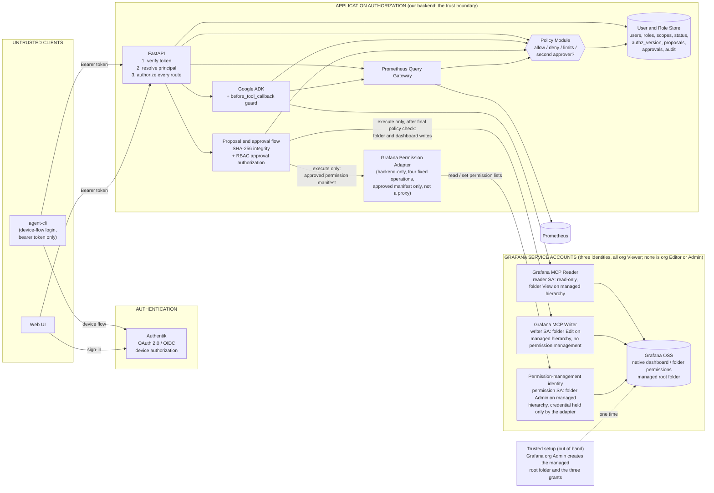

## 1. Executive summary and selected approach

### 1.1 Selected approach (preserved)

Authorization is decided in one place: **our application**. The selected approach is **central application-level RBAC using FastAPI, Google ADK, Grafana OSS, least-privilege Grafana service accounts and a Prometheus Query Gateway**. Users authenticate with **Authentik**. FastAPI verifies the identity token, resolves the user from a trusted database, and asks a single **Policy Module** whether each action on each resource is allowed. Grafana is reached only through three separate least-privilege service accounts (reader, dashboard writer and permission management; section 11.3), none of which is an organization Editor or Admin, and Prometheus only through the Query Gateway.

Three responsibilities stay separate:

| Layer | Responsibility | Where it lives |
|---|---|---|
| **Authentication** | Proves *who the user is*. | Authentik (issues tokens); FastAPI (verifies them). |
| **Application authorization** | Decides *what the user may do through the agent and its backend*. | User and Role Store, Policy Module, enforced by FastAPI, ADK guard, proposal flow and Query Gateway. |
| **Grafana-native permissions** | Decide what a Grafana identity can do *inside Grafana*: the ceiling for the application's service accounts, and the access of people who use Grafana directly. | Grafana OSS. |

> **A user's effective permission through the agent = the lower of (what the application policy allows this user, from current backend data) and (what the Grafana service account used for that call is allowed to do).**
>
> Separately, anyone who opens Grafana directly is governed only by Grafana-native permissions. The two layers are coordinated, but neither replaces the other.

The four **application** roles are `observer`, `maintainer` (Dashboard Maintainer), `operator` (On-call Operator) and `admin` (Administrator). The application Administrator is **not** automatically a Grafana Administrator, and Grafana Admin is never used by the application.

### 1.2 What this report adds to the original architecture

| Topic | Original report | This report |
|---|---|---|
| Identity provider | Left open ("one must be chosen"). | **Authentik is the selected provider**; device-flow login for the CLI; the Authentik configuration our project implements is defined in section 4.6. |
| CLI | Not covered. | `agent-cli` is an untrusted client of FastAPI; command contract, four scope modifiers and gaps in the reference code (section 6). |
| Scopes | Folder UIDs and environments. | Four lists: explicit dashboard deny, explicit dashboard allow, folder allow, environment allow, with one consistent evaluation rule (section 8). |
| Approval | Described as tied to identity, scope and execute-time re-checks, but the owner confirms that **today any user can approve a dashboard proposal**. | A dedicated approval authorization decision, separation of duties, and execute-time re-authorization layered onto the existing SHA-256 workflow (section 9). |
| Selective dashboard access | Not covered. | A permission manifest inside the proposal, applied to Grafana through a narrow backend adapter, verified and audited, with a folder-first strategy (sections 10 and 11). |
| Grafana service accounts | A restricted writer service account, with an organization-level Viewer or Editor role offered as alternatives. | **Three** service accounts, all with the organization role Viewer: a read-only reader, a dashboard writer with folder Edit on the agent-managed hierarchy, and a permission-management identity with folder Admin on that hierarchy only. No organization Editor or Admin (section 11.3). |

### 1.3 The critical corrections

1. **Approval is currently unauthorized. [Existing]** A SHA-256 digest of the proposal exists and is used as an integrity check, but any user can approve a dashboard proposal. A digest proves that content is unchanged; it does not prove that the person approving is allowed to approve. **[Requirement]** Approval must be authorized server-side from the verified identity, current role, account status, resource scope, operation risk class and separation-of-duties rules (section 9).
2. **Selective permissions are two separate changes. [Requirement]** "Give the payments-oncall team View access" requires a Grafana-native permission change; updating the application database does not do that, and a Grafana permission does not grant anything inside the agent. Both must be in the approved proposal, applied separately, verified separately and audited (sections 10 and 11).
3. **The ordinary dashboard writer must not be an organization Editor, and nothing may be an organization Admin. [Requirement]** An organization-level Editor has write capability well beyond the folders the agent manages, and folder permissions cannot be assumed to remove access that a broader path already grants. The writer is an organization Viewer with folder Edit on the managed hierarchy only; permission changes are made by a separate, narrowly scoped identity that only the backend Permission Adapter holds (section 11.3).

### 1.4 What is established, proposed and unverified

| Item | Status |
|---|---|
| Proposal/approval flow with versioning and a SHA-256 digest check | **[Existing]** (owner confirmation; the original archive review also describes version and digest binding). |
| Any user can approve a dashboard proposal | **[Existing]** (owner confirmation). This is the gap to close. |
| Approval token that is single-use, short-lived and bound to the approver | **[Verify]**. The original design describes it; whether the current implementation has each property is not established by the supplied materials. |
| Persistent proposals, users, roles, scopes, audit tables | **[Recommended]**. The archive review found in-memory proposal stores and no user or role data; later changes are not known. |
| Authentik provider, application, device-flow and client configuration | **[Requirement]**, defined in section 4.6. Not yet implemented or tested. |
| Three Grafana service accounts, the managed root folder and the permission-management identity | **[Recommended]** design (section 11.3). Not yet implemented or tested; local tests are listed in section 11.9. |
| Central Policy Module, approval policy, permission adapter | **[Requirement]** with a **[Recommended]** design in this report. |
| Every command, endpoint and table in the CLI document | Design examples; **[Verify]** each against the code. |

---

## 2. Architecture diagram



### 2.1 How the components interact end to end

1. **Sign-in.** The user authenticates with Authentik, through the browser (UI) or the device flow (`agent-cli auth login`). Authentik issues a signed token.
2. **Every request.** The client sends `Authorization: Bearer <token>` to FastAPI. FastAPI verifies the token, extracts `(issuer, subject)`, and loads the user's **current** role, scopes, status and `authz_version` from the User and Role Store. The result is a server-side `Principal`.
3. **Decision.** FastAPI asks the Policy Module `Principal × action × resource`. The same module serves FastAPI routes, the ADK guard, the proposal flow, the admin API and the Query Gateway.
4. **Conversation.** ADK runs under the authenticated user id. Before each tool call the guard re-resolves the principal and asks the Policy Module. The model proposes; it never authorizes or executes.
5. **Reads.** Permitted reads go through the MCP Reader (reader service account, organization Viewer, read-only). Prometheus queries from every path go through the Query Gateway.
6. **Writes.** A write exists only as a **proposal**: created (authorized), approved (authorized, integrity-checked), then executed (re-authorized, re-checked). Only the execute step touches the MCP Writer (writer service account: folders and dashboards) and the Permission Adapter (permission-management service account: permission lists only).
7. **Grafana.** Grafana enforces each service account's own permissions and the native permissions on each resource. The ordinary writer cannot change permissions. The permission-management identity changes only permission lists, only inside the managed hierarchy, and only through the adapter. The managed root folder is created once by a trusted administrator outside the agent (section 11.3).
8. **Audit.** Every decision, allowed or denied, is written to the append-only audit log.

---

## 3. Component responsibilities and trust boundaries

### 3.1 Responsibilities

| Component | Responsibility | Trusted for |
|---|---|---|
| **Authentik** | Authenticates users and establishes identity. Issues signed tokens. Does **not** decide application roles or scopes. | Proving who the user is. |
| **FastAPI** | Verifies the token, resolves the current principal, authorizes every route, hosts the admin API and proposal endpoints. | Enforcement point. |
| **User and Role Store** | Persists users, roles, the four scope lists, account status, `authz_version`, proposals, approvals and audit records. | Source of truth for authorization data. |
| **Policy Module** | The single decision point: `Principal × action × resource` returns allow/deny, limits to apply and whether a second approver is required. Deny by default. | Decisions. |
| **Google ADK** | Handles agent interaction and invokes tools; a `before_tool_callback`-based guard asks the Policy Module before each call. | Orchestration only. |
| **CLI (`agent-cli`)** | A command-line client of FastAPI. | **Nothing.** It is untrusted. |
| **Grafana MCP Reader** | Performs permitted read operations with the reader service account (organization Viewer, folder View on the managed hierarchy). | Reads only. |
| **Grafana MCP Writer** | Performs approved folder and dashboard mutations after the final authorization check, with the writer service account (organization Viewer, folder Edit on the managed hierarchy). It has no permission-management capability. | Writes, only from the execute step. |
| **Grafana Permission Adapter** | **[Recommended]** A narrow backend module that applies and reads approved dashboard or folder permission lists through four fixed Grafana API operations (section 11.4), using the permission-management service account. Not exposed to the model, the CLI or any generic API tool. | Applying approved permissions. |
| **Permission-management identity** | **[Recommended]** A Grafana service account (organization Viewer) with folder Admin on the managed root and on explicitly enrolled folders only (section 11.3). Its credential is held only by the Permission Adapter process. | Permission lists inside the managed hierarchy. |
| **Prometheus Query Gateway** | Enforces the permitted query scope, limits and metric restrictions on every Prometheus access path. | Prometheus access. |
| **Grafana OSS** | Enforces the permissions of its service accounts and the native permissions on its resources. | Grafana-side ceiling. |

### 3.2 Trust boundaries

| Boundary | What crosses it | Rule |
|---|---|---|
| **Client → FastAPI** | A bearer token and request fields. | Everything except the verified token is untrusted input. Roles, user ids, approver ids and scopes in bodies, arguments, conversations or model output are ignored. |
| **Authentik → FastAPI** | Signed JWT; JWKS. | FastAPI trusts only tokens that verify against the configured issuer, keys and audience. |
| **FastAPI → User and Role Store** | Principal lookups, writes with audit. | The store is security-critical: access control, backups, transactional audit. |
| **Backend → Grafana** | Three service-account tokens. | Tokens are held only by the backend. The reader token goes only to the MCP Reader, the writer token only to the MCP Writer, and the permission-management token only to the Permission Adapter. Clients never hold any of them. |
| **Backend → Prometheus** | Queries. | Only the Query Gateway may reach Prometheus; network access is restricted to the backend and Grafana. |
| **Model ↔ backend** | Tool calls and tool results. | Tool arguments and results are untrusted. A denied call never executes. |

### 3.3 Invariants

**[Requirement]** The CLI must never:

- hold Grafana service-account credentials;
- contact Grafana or Prometheus directly;
- make a security decision locally (a client-side check is a usability hint, not a control);
- choose its own authenticated identity;
- submit an approval on behalf of an arbitrary user;
- bypass FastAPI or the central Policy Module.

**[Requirement]** The Grafana credentials must follow these rules:

- the permission-management credential is never exposed as a model-facing tool, a CLI credential, an MCP tool argument or a generic API capability;
- the Permission Adapter never forwards a path, method or payload supplied by the model, the CLI or an HTTP request body;
- no generic Grafana API tool (such as `grafana_api_request`) is available to the model, the reader or the writer;
- no Grafana service account holds the organization Editor or Admin role.

**[Requirement]** Do not trust a role, user ID, approval identity or permission scope because it appears in the token payload, CLI arguments, an HTTP request body, the conversation or model output. The identity comes from the verified token; the authorization data comes from the trusted database, resolved server-side on each request.

---

## 4. Authentik authentication and identity resolution

Authentik is the identity provider selected for this project because the HPE team already uses it. This is an established decision, not an open choice. This section specifies the Authentik configuration and FastAPI verification that **our project implements**; it does not assume any pre-existing Authentik deployment. **Authentik verifies identity; the application determines permissions.**

### 4.1 Intended flow (CLI)

| # | Step | Component | Status |
|---|---|---|---|
| 1 | The user runs `agent-cli auth login`. | CLI | Intended (CLI document). |
| 2 | The CLI starts the OAuth 2.0 **Device Authorization** flow by posting its `client_id` and the requested scopes, in the singular `scope` parameter (space-delimited), to Authentik's device endpoint (`/application/o/device/`). | CLI → Authentik | **[Requirement]**, configured as in section 4.6. |
| 3 | The user completes authentication on Authentik's verification page, using the code the CLI displays. | User, Authentik | Intended. |
| 4 | The CLI polls the token endpoint at the interval Authentik returns and receives the token set. | CLI → Authentik | Intended; the reference code needs hardening (section 6.6). |
| 5 | Each CLI request sends the bearer token to FastAPI. | CLI → FastAPI | Intended. |
| 6 | FastAPI validates the token against trusted issuer and signing-key configuration: signature, issuer, audience, expiry (4.3). | FastAPI | **[Requirement]** |
| 7 | FastAPI resolves the identity by the stable `(issuer, subject)` pair. | FastAPI | **[Requirement]** |
| 8 | The backend loads the current role, scopes, account status and `authz_version` from the trusted database. | FastAPI, Store | **[Requirement]** |
| 9 | The Policy Module decides whether the requested operation is allowed. | Policy Module | **[Requirement]** |

The web UI uses the same validation and resolution (steps 5 to 9) with Authentik's browser-based flow. Everything after the token arrives is identical for the CLI and the UI.

### 4.2 Why the device flow suits the CLI

The device flow is designed for clients without a convenient browser. The CLI never sees the user's password or Authentik session; the user authenticates in Authentik's own interface. No static API key is needed on the client. Authentik documents the device flow as [RFC 8628](https://datatracker.ietf.org/doc/html/rfc8628) behavior ([Authentik device code documentation](https://docs.goauthentik.io/add-secure-apps/providers/oauth2/device_code/)), with the device endpoint at `/application/o/device/`, a request that names the singular `scope` parameter, and a token response that carries an access token (and, per its documentation, an ID token).

### 4.3 Token validation in FastAPI **[Requirement]**

Applied in one dependency attached to every route, including routes behind any proxy or alternative entry point that is kept.

| Check | Rule | Notes |
|---|---|---|
| **Signature** | Verify against the provider's published keys (Authentik serves them at `/application/o/<application slug>/jwks/`). Accept only an allow-listed asymmetric algorithm; reject `none` and algorithm switching. Refresh the key set when an unknown `kid` appears. | The provider is configured with an RSA signing key (section 4.6), so tokens are signed asymmetrically and the keys are published at the JWKS URL. Follow [JWT best current practices (RFC 8725)](https://datatracker.ietf.org/doc/html/rfc8725). |
| **Issuer** | Exact match with the configured issuer. | Authentik issues a **different issuer per provider** (derived from the application slug) by default; this project uses that per-provider mode, so the issuer is `https://<authentik-host>/application/o/<application slug>/` (section 4.6). |
| **Audience** | Must contain the client id(s) this API accepts (CLI client, and the UI client if separate). | Reject tokens minted for other applications on the same Authentik instance. Local test A4 (section 4.6) decodes a real token from our own Authentik and asserts the `aud` value that the allow-list is configured with. |
| **Expiry** | `exp` (and `nbf`/`iat` if present) with a small clock leeway. | Keep access tokens short-lived. This bounds how long an Authentik-side deactivation can be ignored; the application's own status check handles application-side revocation immediately (section 5.5). |
| **Token type** | The API bearer is the **access token** (a signed JWT). ID tokens are never accepted as a bearer. | FastAPI rejects a token that carries ID-token-only claims (for example `nonce` or `at_hash`). Local test A6 confirms this separates the two token types in our provider. |
| **Subject** | `sub` is required and non-empty. | See 4.4. |

### 4.4 Identity resolution

- The application's identity key is the pair **(issuer, subject)**. Email, username and display name are informational and are never used to look a user up or to make a decision.
- Authentik lets the provider's *subject mode* be configured. This project sets the provider to a stable, opaque, user-ID-based mode ("Based on the hashed User ID"), not one derived from a mutable username or email (section 4.6). Treat any later change of subject mode as an identity migration.
- **Unknown identity:** create a user record with status `pending`, no role and no permissions.
- **`pending` or `deactivated`:** deny everything except the minimal "who am I / what is my status" endpoint.
- **`active`:** build the `Principal` from the stored role, the four scope lists, status and `authz_version`.

### 4.5 What the token is never used for

Role, scope, permission or group claims in the token are ignored for authorization, even if Authentik is configured to emit them. The same applies to a user id, approver id or role found in a CLI argument, request body, conversation or model output.

### 4.6 Authentik configuration this project implements **[Requirement]**

These are the configuration and implementation steps the project needs. They are written against the official [Authentik OAuth 2.0 provider](https://docs.goauthentik.io/add-secure-apps/providers/oauth2/) and [device code flow](https://docs.goauthentik.io/add-secure-apps/providers/oauth2/device_code/) documentation. A development Authentik (for example a container started for local testing) is sufficient to implement and test them. Nothing here is implemented or tested yet.

**Authentik objects to create**

| # | Object | Setting | Purpose |
|---|---|---|---|
| 1 | **Device code flow** | Create a flow with the designation "Stage configuration" and set it as the brand's device code flow. Authentik ships no default flow for this. | Without it the device endpoint cannot run. |
| 2 | **Signing key** | Create or select an RSA certificate-key pair for the provider. | With a signing key, tokens are signed asymmetrically and the public keys are published at `/application/o/<application slug>/jwks/`. Without one Authentik signs with the client secret, which FastAPI must not accept. |
| 3 | **OAuth2/OpenID provider for the CLI** | Client type **public** (no embedded secret); fixed client id (the reference code uses `grafana-ai-agent-cli`); the device-code grant enabled; signing key from step 2; issuer mode per provider; subject mode "Based on the hashed User ID". | Registers the CLI as a device-flow client. |
| 4 | **Scope mappings** | `openid`, `profile`, `email`, and `offline_access` only if the CLI will use refresh tokens. No role, group or permission scope is needed, because claims are never used for authorization (4.5). | Minimal claims; the user's role comes from our store. |
| 5 | **Token lifetimes** | Short access-token validity (minutes, for example 5 to 15); refresh-token validity set deliberately. | Bounds how long an Authentik-side deactivation can be ignored. Application-side revocation is immediate (5.5). |
| 6 | **Application** | Create an application with a fixed slug (for example `grafana-ai-agent`), bind it to the provider, and bind an Authentik group or policy that decides who may sign in at all. | Authentication gate. It does **not** assign application roles. |
| 7 | **UI provider (if the Web UI is built)** | A separate provider and client id using the authorization-code flow with PKCE and exact redirect URIs. | Keeps UI and CLI clients distinct; both client ids go on the FastAPI audience allow-list. |

**How the CLI requests scopes.** The device request is a form POST to `/application/o/device/` with `client_id=<cli client id>` and `scope=openid profile email` (add `offline_access` if refresh is used). The parameter name is the singular `scope`, as in RFC 8628, the Authentik documentation example and the reference code. The CLI then polls the token endpoint with the device-code grant at the interval Authentik returns and must handle `authorization_pending`, `slow_down`, `expired_token` and `access_denied` (6.6).

**FastAPI verification configuration**

| Setting | Value |
|---|---|
| Issuer | `https://<authentik-host>/application/o/<application slug>/` |
| JWKS URL | `<issuer>jwks/` (cached; refreshed on an unknown `kid`) |
| Allowed algorithms | `RS256` only |
| Audience allow-list | CLI client id, plus the UI client id if separate |
| Clock leeway | A few seconds |
| Required claims | `iss`, `aud`, `exp`, `sub` |
| Identity key | `(iss, sub)` (4.4) |

**Local testing criteria (our own development Authentik and our own FastAPI)**

| Test | Pass condition |
|---|---|
| **A1** End-to-end device login | `agent-cli auth login` completes; a token set is stored with `0600` permissions; `GET /auth/whoami` returns the resolved principal. |
| **A2** Scope parameter | The device request uses `scope`. The token response or decoded token shows the requested scopes were applied; a request that uses `scopes` does not. |
| **A3** Signature and algorithm | The token header shows RS256 and a `kid` present in the JWKS. FastAPI rejects `alg=none`, an HS256 token signed with the client secret, and a token signed by another key. |
| **A4** Issuer and audience | The decoded `iss` equals the configured issuer. A token minted for a different Authentik application is rejected. |
| **A5** Expiry | An expired token is rejected; a token inside the leeway window is handled as configured. |
| **A6** Token type | An ID token presented as a bearer is rejected; the access token is accepted. |
| **A7** Revocation behavior | After an application-side `deactivated` status, the next request with an unexpired token is refused (5.5). |
| **A8** Polling | The CLI handles pending, slow-down, expired and denied responses without looping forever. |

---

## 5. User, role and scope management

### 5.1 What the store holds **[Recommended]**

The original archive review found no user, role or persisted-proposal data, and the CLI document describes the intended shape. None of the tables below is assumed to exist. Use SQLite for development and a server database such as PostgreSQL for shared use.

| Data | Contents |
|---|---|
| **Users** | Internal user id; Authentik `issuer` and `subject` (unique together); display name and email (informational); `status` (`pending`, `active`, `deactivated`); created and last-seen timestamps; `authz_version`, incremented on any change to the user's access. |
| **Role assignment** | One application role: `observer`, `maintainer`, `operator` or `admin`. |
| **Scopes** | Four lists per user: `allowed_folder_uids`, `allowed_dashboard_uids`, `denied_dashboard_uids`, `allowed_environments` (evaluated in section 8.2). |
| **Proposals** | Proposal id, version, owner (proposer), operation type, impact classification, target and destination, canonical content and its SHA-256 digest, state, policy version, timestamps. |
| **Approvals** | Proposal id, version, digest, approver user id, decision, approver `authz_version`, timestamps, token identifier, token expiry and use state (section 9.7). |
| **Audit log** | Append-only record of security-relevant events (section 13.1). |

### 5.2 User lifecycle **[Requirement]**

| Stage | Behavior |
|---|---|
| **First sign-in** | Authentik authenticates the user. FastAPI creates a `pending` record with **no role and no privileges**. The user can see only that access is awaiting activation. A role can never be chosen or requested through the token or request body. |
| **Activation** | An Administrator activates the user and assigns a role and scopes. |
| **First Administrator** | Established by a **trusted server-side or deployment-side bootstrap**, never by the public API (below). |
| **Change** | An Administrator can change role and scopes, which increments `authz_version`. |
| **Deactivation** | Sets `deactivated`; access stops on the next request. |

**Bootstrap rules.** The deployment operator configures the initial Administrator's `(issuer, subject)` in the deployment environment, or runs a one-time command on the host. The bootstrap applies only while **no active Administrator exists**, cannot be triggered by any API call or user-supplied value, is recorded in the audit log, and the bootstrap setting is removed after use. The CLI document shows this as `agent-cli bootstrap-admin`; **[Recommended]** ship it as a server-side management command that needs database access on the host rather than as a subcommand of the user-facing CLI, so the user CLI contains no privileged path.

### 5.3 Administrator operations **[Requirement]**

All require the `admin:users` permission, checked by the Policy Module against the caller's **current stored role**.

| Operation | Behavior |
|---|---|
| List and view users | Status, role, scopes, last seen. |
| Activate and assign role | Moves `pending` to `active` with a role and scopes. |
| Change role | Previous and new values are audited. |
| Set scopes | Sets the four lists. Folder and dashboard UIDs are validated against Grafana through the reader account so that scopes refer to real resources. |
| Deactivate | Status becomes `deactivated`. Pending proposals and approvals owned or issued by the user are invalidated or re-checked at execution (section 9.6). |
| Read audit log | Role, scope and decision history. |
| Read other users' sessions and proposals | Allowed, and itself audited. |

### 5.4 Administrative security **[Requirement]**

- **No self-service privilege change.** An Administrator cannot change their own role, scopes or status; another Administrator must.
- **Last-Administrator protection.** Any change that would remove or deactivate the last active Administrator is refused.
- **No client-supplied authority.** Role, scope and status values come only from the admin request, validated server-side against the allowed role names and real Grafana UIDs.
- **Atomic with audit.** Each change and its audit record are written in one database transaction, so a change cannot happen unlogged.
- Users cannot grant themselves elevated privileges by any route, including by proposing and approving a scope change.

### 5.5 Revocation and caching **[Requirement]**

- The principal is read from the store on every request. If a cache is used, it holds the stored record (not token claims) for seconds, is keyed by `authz_version`, and is invalidated on change, so it never outlives a revocation by more than its documented lifetime.
- ADK and UI sessions store only the user id. Permissions are re-resolved at each tool call, so a session opened under an old role cannot keep using it.
- A deactivated user's next call is refused, even though their Authentik token may still be unexpired.

### 5.6 Distinctions to keep

| Concept | What it is | Where enforced |
|---|---|---|
| **Application role** | A coarse capability set (observer, maintainer, operator, admin). | Policy Module. |
| **Dashboard permission (action)** | A specific verb such as `dashboard:propose`, `dashboard:approve`, `dashboard:execute`. Given by the role. | Policy Module. |
| **Folder / dashboard scope** | Which Grafana resources the permission applies to. | Policy Module (section 8.2). |
| **Environment restriction** | Which `env` values Prometheus queries and alert changes may touch. | Query Gateway and Policy Module. |
| **Grafana-native permission** | A View/Edit/Admin entry on a Grafana folder or dashboard for a user, team or role. | Grafana (section 11). |

---

## 6. CLI architecture and command examples

### 6.1 Contract

`agent-cli` is a thin, **untrusted** client. All operations go through the authenticated FastAPI backend. It stores only a user token (the CLI document proposes `~/.config/grafana-agent/token.json` with `0600` permissions), and the backend resolves identity, role and scope on every call. A CLI that is modified, replaced or replayed with `curl` gets exactly the same decisions, because the decisions are made server-side.

### 6.2 Command groups

| Group | Purpose | Backend route in the reference code | Available to |
|---|---|---|---|
| `agent-cli auth` | Login (device flow), identity check. | `GET /auth/whoami` (login uses Authentik directly) | All roles |
| `agent-cli chat` | Conversation through ADK. | Not in reference code | All roles; tools offered depend on role and are re-checked per call |
| `agent-cli query` | Catalog queries and custom PromQL through the Query Gateway. | `POST /query/promql` | Catalog: all; custom PromQL: not `observer` |
| `agent-cli dashboard` | List/get, propose, approve, execute. | `POST /proposals/dashboard`, `POST /proposals/{id}/approve`, `POST /proposals/{id}/execute` | Read: all (within scope); propose/approve/execute: `maintainer`, `admin` |
| `agent-cli alert` | Propose, approve, execute alert rules. | `POST /proposals/alert` (approve/execute not shown) | `operator`, `admin` |
| `agent-cli admin` | Users, roles, scopes, audit. | `PUT /admin/users/{id}/access` | `admin` only |

### 6.3 The four selective scope modifiers

Grafana OSS roles are coarse (Viewer, Editor, Admin). The four scope lists let the **application** express finer access. They are set only by an Administrator, through `agent-cli admin scopes set` (or the admin API). They are enforced by the Policy Module on the server, never by the CLI. The exact formula and exceptions are in section 8.2.

| CLI flag | Stored list | Purpose | Precedence |
|---|---|---|---|
| `--deny-dashboard <uid>` | `denied_dashboard_uids` | Block named sensitive dashboards even when their folder is allowed. | **1 (highest)**: overrides every allowance. |
| `--allow-dashboard <uid>` | `allowed_dashboard_uids` | Grant access to individual dashboards **without** allowing the rest of their folder. | 2 |
| `--allow-folder <uid>` | `allowed_folder_uids` | Grant the broader set of dashboards and alert rules in a folder. Required for **creating** dashboards in that folder. | 3 |
| `--allow-env <env>` | `allowed_environments` | Constrain Prometheus queries (mandatory `env` matcher) and alert-rule changes to the listed environments. | 4 (a separate dimension from dashboards and folders, applied together with them) |

### 6.4 Examples

These follow the CLI document and are consistent with the rules in sections 8 and 9. Output text is illustrative.

**Authentication**

```bash
$ agent-cli auth login
Open https://<authentik-host>/... and enter code: ABCD-EFGH
Authenticated: user_id=usr_201 role=observer status=active
```

**Observer: read and curated queries only**

```bash
$ agent-cli dashboard list --folder fld-prod-overview
$ agent-cli query catalog http_request_rate --service checkout --range 6h
[200 OK] 12 series (env="staging" enforced by the Query Gateway)

$ agent-cli query promql 'sum(rate(http_requests_total[5m])) by (pod)'
[403 Forbidden] Policy Denied: role 'observer' lacks 'promql:custom'.
```

**Maintainer: routine edit, self-approved**

```bash
$ agent-cli dashboard propose --uid dash-checkout-slo --prompt "Add a p99 latency panel"
[201 Created] Proposal prop_8821  Impact: routine_edit  Version: 1  Digest: sha256:7f83b165...

$ agent-cli dashboard approve prop_8821 --version 1 --digest sha256:7f83b165...
[200 OK] Approval token issued (single use, expires in 300s)

$ agent-cli dashboard execute prop_8821 --token appr_tok_...
[200 OK] Executed. Audit ID: aud_55012
```

**Maintainer: denied dashboard and deletion needing a second approver**

```bash
$ agent-cli dashboard propose --uid dash-pci-compliance --prompt "Remove audit panel"
[403 Forbidden] Policy Denied: 'dash-pci-compliance' is in denied_dashboard_uids.

$ agent-cli dashboard propose --uid dash-checkout-slo --delete --reason "Deprecated"
[201 Created] Proposal prop_8822  Impact: destructive_delete  Requires second approver

$ agent-cli dashboard approve prop_8822 --version 1 --digest sha256:4a12c900...
[403 Forbidden] Policy Denied: 'dashboard:delete' requires an approver other than the proposer.
```

**Administrator: activate a user and set scopes**

```bash
$ agent-cli admin scopes set usr_104 --status active --role maintainer \
    --allow-folder fld-payments --allow-dashboard dash-global-overview \
    --deny-dashboard dash-pci-compliance --allow-env staging
[200 OK] Folder and dashboard UIDs validated against Grafana. usr_104 authz_version=2.

$ agent-cli admin scopes set usr_001 --role admin --allow-folder "*"
[403 Forbidden] Administrators cannot modify their own role, scopes, or status.
```

A permission-aware dashboard request is shown in section 10, and an unauthorized approval attempt in section 9.8.

### 6.5 Command extensions this design needs **[Recommended]**

| Need | Proposed CLI contract | Server-side rule |
|---|---|---|
| Show exactly what will be approved | `agent-cli dashboard show <proposal-id>` prints the canonical content: definition summary, destination folder and the permission manifest, plus the digest. | The server renders it from the stored proposal. |
| Request selective permissions | `agent-cli dashboard propose ... --grant team:<name>=view --grant user:<login>=edit`, or the same request made in chat. | Grants become a manifest in the proposal, authorized per grant (section 10). |
| Approve | `agent-cli dashboard approve <id> --version N --digest sha256:...` | The client sends **no approver id**. The approver is the authenticated principal. |

### 6.6 Reference code versus the command matrix **[Verify]**

The CLI document's reference code is incomplete relative to its command matrix. Only the following differences matter for this design.

| Item | In the reference code | In the command matrix/examples |
|---|---|---|
| Implemented commands | `auth login`, `dashboard propose/approve/execute`, `alert propose`, `query promql`, `admin scopes-set` | Also `chat`, `query catalog`, `dashboard get/list`, `alert approve/execute`, `admin users list/deactivate`, `admin audit tail`, `bootstrap-admin` |
| Names | `--delete` flag; `scopes-set` | `propose-delete`; `scopes set` |
| Login polling | Loops until HTTP 200; does not handle the RFC 8628 "pending", "slow down", "expired" or "access denied" responses, so a pending login can fail unclearly or loop forever. | Not described. |
| Token storage | Writes the whole token response, then sets permissions afterward. | `0600` file. Create the file with restrictive permissions atomically, or use the OS credential store. |
| Constants | `API_BASE_URL` and `AUTHENTIK_BASE` contain Markdown link text rather than plain URLs. | Placeholder hosts. |
| Scope parameter | Sends `scope`. | Correct: RFC 8628 and Authentik's documented example both use the singular `scope` (section 4.6). |
| Token refresh/logout | None. | Not described. |

None of these changes the security model, because the CLI holds no authority; they affect usability and the quality of the login experience.

---

## 7. Four-role permission matrix

These are **application** roles. "Admin" never implies Grafana Admin. Role limits for Prometheus are illustrative placeholders, not verified implementation values (section 12).

| Capability | Observer | Dashboard Maintainer | On-call Operator | Administrator |
|---|---|---|---|---|
| Chat, `auth` commands | ✔ | ✔ | ✔ | ✔ |
| Read dashboards and alert rules | ✔ within scope | ✔ within scope | ✔ within scope | ✔ (global, minus explicit denies) |
| Catalog Prometheus queries | ✔ scoped to `env` | ✔ scoped | ✔ scoped | ✔ |
| Custom PromQL | ✖ | ✔ parsed and `env`-scoped | ✔ parsed and `env`-scoped | ✔ bounded |
| Propose dashboard create or edit | ✖ | ✔ within scope | ✖ | ✔ |
| **Approve** routine dashboard edit | ✖ | ✔ within scope; **self-approval allowed** | ✖ | ✔ within scope and risk controls; self-approval allowed |
| Execute approved dashboard operation | ✖ | ✔ within scope | ✖ | ✔ |
| Propose dashboard **deletion** | ✖ | ✔ within scope | ✖ | ✔ |
| **Approve** dashboard deletion | ✖ | ✔ within scope, **only as a different person from the proposer** | ✖ | ✔ **only as a different person from the proposer** |
| Request selective Grafana permission grants in a proposal | ✖ | ✔ View/Edit levels only, on resources in own scope, to eligible subjects **[Recommended]** | ✖ | ✔ all levels the policy permits |
| **Approve** a proposal that changes permissions (`access_change`) | ✖ | ✔ **only as a different person from the proposer** **[Recommended]** | ✖ | ✔ **only as a different person from the proposer** |
| Propose alert rules | ✖ | ✖ | ✔ assigned folders and environments | ✔ |
| Approve/execute routine alert creation | ✖ | ✖ | ✔ self-approval allowed | ✔ |
| Critical production alert changes | ✖ | ✖ | ✔ **second approver required** | ✔ **second approver required** |
| Read other users' sessions and proposals | ✖ | ✖ | ✖ | ✔ audited |
| Manage users, roles, scopes; read audit log | ✖ | ✖ | ✖ | ✔ no self-edit; last-admin guard |

Notes:

- Propose, approve and execute are **separate permissions**. Each is limited by scope (section 8.2) and by the operation's impact class (section 8.4).
- **Operators cannot approve dashboard changes.** The baseline policy is kept; changing it would be an explicit policy revision.
- The two `access_change` rows are an addition to the baseline (section 8.4). The baseline itself does not mention permission changes.

---

## 8. Central Policy Module and resource-scope enforcement

### 8.1 Decision inputs

The Policy Module is a pure, unit-testable function over **server-resolved** inputs: the `Principal` (user id, issuer, subject, role, status, `authz_version`, the four scope lists), the action, the resource (dashboard UID, its folder UID, destination folder, environment, alert severity), and for approvals the proposal (proposer, impact class, version, state). It returns allow or deny, a reason, applicable limits and whether a second approver is required. **Deny by default.** It is called by FastAPI routes, the ADK guard, the proposal flow, the admin API and the Query Gateway so all layers agree.

Resource identity is normalized **before** the decision: a dashboard UID is resolved to its folder by the backend (through the reader), never taken from model text or the request.

### 8.2 Resource-scope evaluation **[Requirement]**

Dashboard decision for a principal with `denied`, `allowed_dashboards` and `allowed_folders`:

```
is_dashboard_permitted(uid, folder_uid) =
    ( uid NOT IN denied_dashboard_uids )
    AND ( role == admin
          OR uid IN allowed_dashboard_uids
          OR folder_uid IN allowed_folder_uids )
```

| Rule | Behavior |
|---|---|
| **Explicit deny wins** | A dashboard in `denied_dashboard_uids` is refused for every role, including `admin`, for every action. It overrides an inherited folder allowance and an explicit dashboard allowance. |
| **Individual allow** | `allowed_dashboard_uids` makes that one dashboard accessible **without** allowing its folder, at the application-policy level. |
| **Folder allow** | `allowed_folder_uids` covers the folder's dashboards and alert rules, minus explicit denies. |
| **Administrator** | Has implicit global scope, but is still subject to explicit denies and to risk controls (second approver, no self-edit). |
| **Creating a dashboard** | The **destination folder** must be in `allowed_folder_uids` (an individual dashboard allow cannot authorize creation, because the dashboard does not exist yet). |
| **Moving a dashboard to another folder** | Both the dashboard and the destination folder must be permitted. |
| **Alert rules** | A non-admin needs `folder_uid IN allowed_folder_uids` **and** `environment IN allowed_environments`. Dashboard allow/deny lists do not apply to alert rules. |
| **Environment** | `allowed_environments` constrains Prometheus queries (the gateway injects and enforces the matcher) and alert-rule operations. It does not by itself grant dashboard access. |
| **Empty lists** | An empty list grants nothing (deny by default). |

**Same formula for read and write.** The CLI document defines the scope lists as governing access to dashboards, and the original report lists "read dashboards" as available to all roles. These are reconciled as: *the role decides which actions are available; the scope decides which resources they apply to, for reads and writes alike.* An Observer or Operator therefore needs `allowed_folder_uids` or `allowed_dashboard_uids` entries to read dashboards through the agent. This is stricter than the original report's read baseline and matches the deny-by-default principle. If the owner prefers the looser baseline ("all active users may read any dashboard, minus explicit denies"), only the allow-list condition changes for read actions; the deny rule and every write rule stay the same.

**Application-level limit.** Because the MCP Reader is a Viewer service account that can read everything Grafana lets a Viewer read, read scoping is enforced by the application on agent-mediated paths. It does not restrict someone who opens Grafana directly. Section 11 covers that.

### 8.3 Policy decisions **[Requirement]**

| Decision | Inputs checked |
|---|---|
| `authorize_chat_tool(principal, tool, args)` | Active status; tool allowed for role; normalized resource in scope. Used by the ADK guard before every tool call. |
| `authorize_dashboard_propose(principal, operation, target, destination_folder, manifest)` | Active; role; scope per 8.2; each requested permission grant per `authorize_permission_grant`. Assigns the impact class. |
| `authorize_permission_grant(principal, resource, subject, level)` | Role may request grants; resource in scope; level within the role's ceiling; subject eligible (section 10.4). |
| **`authorize_dashboard_approve(principal, proposal, target_resource, impact_classification)`** | Section 9.4. |
| `authorize_dashboard_execute(principal, proposal, approval)` | Section 9.6. |
| `authorize_alert_propose / approve / execute` | Role; folder and environment scope; severity class; second approver for critical. |
| `authorize_promql(principal, query_context)` | Role limits and `env` scope (section 12). |
| `authorize_admin_user_change(principal, target, ...)` | `admin:users`; no self-change; last-admin guard. |

The CLI document's reference `authorize_dashboard_write` combines proposing and approving in one function and checks the second-approver rule against the proposer at the same point. **[Recommended]** split these into separate decisions as above, so proposing a deletion is allowed for a Maintainer while approving it is separately evaluated.

### 8.4 Impact classification and approval rules **[Requirement]**

The Policy Module assigns the impact class when the proposal is created and records it in the proposal.

| Impact class | Examples | Self-approval by proposer | Eligible approvers |
|---|---|---|---|
| `routine_edit` | Edit panels or queries; create a dashboard in a permitted folder with no permission changes. | **Allowed** (original policy preserved). | `maintainer` or `admin`, in scope. |
| `destructive_delete` | Delete a dashboard. | **Not allowed.** Second, different approver required. | A different `maintainer` (in scope) or `admin`. |
| `access_change` **[Recommended addition]** | A proposal whose manifest grants or changes Grafana permissions, or changes application-level access. | **Not allowed.** | A different `maintainer` (in scope) or `admin`. Application-level access changes need an `admin` approver. |
| `routine_alert` | Ordinary alert creation. | **Allowed.** | `operator` or `admin`, in scope. |
| `critical_alert` | Critical production alert change. | **Not allowed.** | A different `operator` (in scope) or `admin`. |

**Why `access_change` is a recommendation and not a baseline rule.** The original policy lets a Maintainer self-approve routine dashboard edits. A proposer who approves their own grant of access to other people removes the independent check that separation of duties exists to provide, and a grant of access is a different kind of risk than a panel edit. The baseline is not changed for routine edits. If the owner prefers that View/Edit grants within one's own scope stay self-approvable, move that case to `routine_edit`; nothing else in the design changes.

### 8.5 Source-document conflicts and the single rule chosen

| # | Conflict or gap | Chosen rule |
|---|---|---|
| 1 | The original report scopes writes to folders; the CLI document adds individual dashboard allow and deny lists. | The four-list formula in 8.2 governs both. Folder allow is required for creation. |
| 2 | The original report does not say whether Administrators are scope-limited; the CLI reference code gives them global scope. | Global scope, but explicit denies apply to everyone, and risk controls (second approver, no self-edit) still bind. |
| 3 | The original report lists reading dashboards as available to all roles; the CLI document's scope lists imply access control for reads. | Role decides actions, scope decides resources, for reads and writes (8.2). |
| 4 | CLI reference code mixes propose and approve in one function. | Separate decisions (8.3). |
| 5 | The CLI matrix says execute "re-checks `authz_version` and digest"; the original says execute re-resolves the current role, scope and status. | Execute **always** re-evaluates against current data. `authz_version` is recorded in approvals and used for cache invalidation and audit, never as the only check (section 9.6). |
| 6 | The CLI document verifies the signature and extracts `(iss, sub)`; the original also validates issuer, audience and expiry. | All of them are validated (section 4.3). |
| 7 | Who may be the second approver for an alert: "2nd on-call Operator or Admin" (CLI) versus "a different user holding the approve permission for that scope, or an Administrator" (original). | The same rule stated two ways. Adopted: a different `operator` in scope, or `admin`. For dashboards: a different `maintainer` in scope, or `admin`. |

---

## 9. Existing proposal, SHA-256 integrity, approval and execution workflow, with RBAC integration

This section preserves the existing proposal workflow and adds the missing authorization. It does **not** rebuild the workflow, and it does **not** claim that role-based approval authorization already exists.

### 9.1 What is established and what is the gap

| Item | Status |
|---|---|
| Proposal and approval flow with versioning | **[Existing]** |
| SHA-256 digest used for integrity verification of the proposal | **[Existing]** (owner confirmation). Exactly which fields the digest covers is **[Verify]**. |
| Approval bound to proposal version and digest | **[Existing]** (original archive review). |
| **Who may approve** | **[Existing] gap:** any user can approve a dashboard proposal. Approval is not tied to a role or scope. |
| Proposal owner, approver identity, impact classification | The original archive review found no proposal owner; **[Requirement]** to add. |
| Approval token that is single-use, short-lived and bound to the approver | **[Verify]**. Retain whichever of these the current mechanism already has; add the rest. |
| Execution-time re-authorization | Described in the original design; **[Verify]** whether implemented. |
| Persistent storage of proposals and approvals | **[Recommended]** (the archive review found in-memory stores). |

### 9.2 Integrity and authorization are different controls

| | SHA-256 integrity verification | Approval authorization |
|---|---|---|
| **Question answered** | "Is this the exact proposal content and version that was reviewed?" | "Is *this authenticated user* allowed to approve *this operation* on *this resource* right now?" |
| **Inputs** | The canonical proposal representation. | Verified identity, current role, account status, scope, operation risk class, separation of duties. |
| **If security-relevant content changes** | The digest changes and approval of the earlier content is invalidated. | Unchanged: a content change does not give anyone approval rights. |
| **What it cannot do** | Establish who the approver is or whether they have permission. Anyone who can read the proposal can see the digest, so knowing it is not a credential. | Detect that the content was changed after review. |
| **Where it fails if used alone** | A caller with the right digest and no permission could approve. This is today's gap. | An authorized approver could approve content that differs from what they reviewed. |

> **A valid digest never substitutes for an authorization check, and a digest is not a permission grant or proof of the approver's identity.** A user who knows or supplies the correct digest is not thereby allowed to approve. Both controls must pass, independently.

### 9.3 The lifecycle, with the RBAC integration

| # | Existing step | RBAC integration added to it |
|---|---|---|
| 1 | A user requests a dashboard operation. | Verify token; resolve the current principal; `authorize_dashboard_propose` checks role, status, folder/dashboard scope and, for any requested grants, `authorize_permission_grant`. |
| 2 | The agent prepares a versioned proposal. | The ADK guard authorizes the tool call. The **proposer is the authenticated principal**, never a value from the model or client. The impact class is assigned by the Policy Module. |
| 3 | The backend records the proposal and calculates or validates the SHA-256 digest. | The digest is computed **server-side** from the stored canonical representation. Proposal owner, impact class and policy version are stored. Where a permission manifest is included, it is part of the digested content (9.7). |
| 4 | An authenticated user submits an approval request for a specific proposal version and digest. | The request carries only `proposal_id`, `version` and `digest`. **No approver id, role or scope is accepted from the client.** |
| 5 | The backend authorizes the approver. | **New:** `authorize_dashboard_approve` (9.4). This replaces "any user can approve". |
| 6 | The approval is recorded against the approver and the exact proposal. | The approver is the authenticated principal; the record stores approver id, proposal id, version, digest, decision, timestamp and the approver's `authz_version`. |
| 7 | The approval-token mechanism is retained where applicable. | The token is issued only after step 5 passes. Bound to proposal id, version, digest and approver; single use; short expiry. **[Verify]** which of these exist today. |
| 8 | Before execution, the backend rechecks authorization and proposal integrity. | Section 9.6. |
| 9 | The approved operation executes through the Grafana MCP Writer (writer service account) for folders and dashboards and, for permissions, through the Permission Adapter (permission-management service account). | Only after step 8; only the fixed, allow-listed operations of each identity; the writer cannot change permissions and the permission identity is not reachable from the model or CLI. |
| 10 | The outcome is audited. | Every step and every denial is audited (section 13). |

### 9.4 The approval authorization decision **[Requirement]**

The decision is conceptually `authorize_dashboard_approve(principal, proposal, target_resource, impact_classification)`. The name is a design example.

It must verify, in this order of intent:

1. **The approver is authenticated.** A valid token that passes the section 4.3 checks.
2. **The backend has resolved the approver's current principal** from the store, not from the token or request.
3. **The approver's account is active.**
4. **The approver holds the specific dashboard approval permission** for the operation's impact class (role matrix, section 7).
5. **The approver's resource scope covers the target** dashboard, or the destination folder for creations, using the rule in section 8.2 (explicit deny wins).
6. **The approver is eligible for that operation's risk category** (for example, only a different `maintainer` in scope, or an `admin`, for a deletion).
7. **Separation of duties holds** whenever an independent second approver is required: the approver is a different person from the proposer.
8. **The proposal exists and is in an approvable state** (not already approved, executed, rejected, expired or superseded).
9. **The request references the correct proposal id, version and digest.** The server recomputes the digest from the stored content and compares.

```python
# Design illustration, not a code rewrite.
def authorize_dashboard_approve(principal, proposal, target, impact, req):
    # principal was built server-side from the verified token + the store.
    if principal.status != "active":                       return deny("account_inactive")
    if not role_allows(principal.role, "dashboard:approve", impact.kind):
                                                           return deny("role_lacks_approval_permission")
    if not scope_permits(principal, target):               return deny("outside_scope")      # 8.2, deny wins
    if impact.requires_second_approver and principal.user_id == proposal.proposer_id:
                                                           return deny("separation_of_duties")
    if impact.requires_admin_approver and principal.role != "admin":
                                                           return deny("admin_required")
    if proposal.state != "pending_approval":               return deny("not_approvable")
    if (req.version, req.digest) != (proposal.version, proposal.canonical_digest()):
                                                           return deny("stale_or_mismatched_proposal")
    return allow(approver=principal.user_id, authz_version=principal.authz_version)
```

**Ordering.** Authorization is evaluated before the integrity comparison, so a caller without permission learns nothing about whether a guessed digest was right. The two checks are independent: in the example of 9.8 the digest would have matched, and the approval is still refused.

**Client-supplied identity is ignored.** FastAPI derives the approver from the verified authenticated identity and the stored principal. A `user_id`, `approver_id`, role or approval claim submitted by the client, or generated by the model, is never used. The CLI and UI send no approver field.

### 9.5 Routine self-approval versus independent approval

| Case | Proposer | Approver | Outcome |
|---|---|---|---|
| Routine edit in the maintainer's scope | Maintainer A | Maintainer A | **Allowed** (original self-approval policy preserved). |
| Routine edit | Maintainer A | Observer or Operator | Denied: role. |
| Routine edit outside the approver's scope, or on an explicitly denied dashboard | Maintainer A | Maintainer B (other folders) | Denied: scope. |
| **Dashboard deletion** | Maintainer A | Maintainer A | **Denied:** separation of duties. |
| Dashboard deletion | Maintainer A | Maintainer B, in scope | **Allowed.** |
| Dashboard deletion | Maintainer A | Admin | **Allowed.** |
| Dashboard deletion | Admin | Same Admin | **Denied:** separation of duties. |
| `access_change` (permission manifest) **[Recommended]** | Maintainer A | Maintainer A | **Denied:** separation of duties. |
| `access_change` | Maintainer A | Admin or Maintainer B in scope | **Allowed.** |
| Any | Any | Deactivated or pending user | Denied: status. |

A role name alone is never enough: scope, operation type, current status and separation-of-duties are checked every time. Routine self-approval is not removed, and it is never applied to an operation class that requires an independent approver.

### 9.6 Authorization at three stages **[Requirement]**

| Stage | What is checked |
|---|---|
| **Proposal creation** | Active principal; role may propose; the target (or destination folder for creations) is in scope; each requested permission grant is within the requester's authority (section 10.4). The proposal stores owner, scope, impact class and policy version. |
| **Proposal approval** | `authorize_dashboard_approve` (9.4). This is where the current unrestricted approval behavior is corrected. |
| **Proposal execution** | Everything in the list below, **before any Grafana write**. |

**Execution-time checks.** An approval does not create privileges the user did not already have, and an approved proposal must not bypass a later role change, scope restriction, deactivation or other authorization change.

1. Authenticate and **re-resolve the executor's current principal**: active, role, scopes. Deny if revoked or deactivated.
2. Load the proposal and approval. Confirm the proposal is still `approved` (not executed, expired, revoked or superseded) and the version is the approved one.
3. **Recompute the digest** from the stored canonical content and compare it with the approved digest. Any change since approval fails the check.
4. Validate the approval token: unexpired, bound to this proposal, version and digest, and **consumed atomically** so it works once.
5. **Re-evaluate the policy decision** for the executor against current data, including the impact class and second-approver requirement.
6. **Re-evaluate the approver's standing [Recommended]:** is the approver still active, still holding the approval permission, still in scope for this target, and still a different person from the proposer where required? If not, the approval is void and the proposal returns to pending.
7. Re-resolve the target UID to its folder from Grafana (through the reader), re-apply the scope rule to the current folder, and confirm that the target and, for permission changes, its current permission list have not drifted since the proposal.
8. Move the proposal to `executing` with an atomic compare-and-swap so two concurrent executions cannot both proceed.
9. Only then use the writer service account for folder and dashboard writes and the permission-management service account (through the Permission Adapter) for permission lists, each through its own allow-list. For a restricted-folder proposal, first run the managed-root drift check (11.3).

`authz_version` is recorded on approvals and used for cache invalidation and audit. It is not a substitute for steps 1 to 7: execution always re-evaluates against current data, so a role change that was not reflected in a cached version cannot be bypassed.

### 9.7 Binding approval to the exact operation

**Established:** a proposal version and a SHA-256 digest that approvals are bound to. **Proposed extension:** make sure the digested content also covers the permission data introduced in section 10, and make the approval record carry the approver.

**Canonical representation (what the digest covers) [Recommended extension; confirm what it already covers]**

| Field | Why it is security-relevant |
|---|---|
| Operation type (create, update, delete, permission change) | Defines what executes. |
| Proposal id and version | Binds the digest to one version. |
| Target dashboard UID, or the intended-creation marker and title | Defines the object. |
| Destination folder (UID, or the specification of a new restricted child folder together with its parent, which is always the managed root) | Changing it changes who inherits access. |
| Proposed dashboard definition or modification | The content that will be written. |
| **Permission manifest:** each subject (type and resolved Grafana id, plus name), permission level, and the inheritance policy | Defines who receives access. |
| Application-level access changes, if included | Changes what users can do through the agent. |
| Impact class and second-approver requirement | Prevents reclassification after approval. |
| Failure policy flags, if any | Changes what happens on partial failure. |

**Excluded from the digest:** approver, timestamps, token values, state and execution results, because they vary independently of the reviewed content.

**How to compute it [Recommended].** Serialize the stored content deterministically (for example RFC 8785 JSON canonicalization), hash with SHA-256 on the server, and compare the client-supplied digest only as a check. Resolve names to stable ids before hashing, and include both, so renaming a team cannot silently retarget a grant.

**Invalidation.** Changing the dashboard definition, destination folder or permission manifest creates a new version and digest and **invalidates approval of the earlier one**. Only the owner (or an Administrator) may modify a proposal, with scope re-checked.

**Approval record.** Bound to: the authenticated approver, proposal id, exact version and digest, the approval decision and the timestamp. Also the approver's `authz_version`, token id, expiry and use state. The existing approval-token design is retained, including whichever of its single-use and expiry properties already exist **[Verify]**.

**Optional hardening.** SHA-256 is unkeyed. Someone who can write to the store could recompute a matching digest. If tamper-evidence against store modification matters, protect stored proposals with an HMAC keyed outside the database. This does not change the authorization design.

### 9.8 Security outcome: unauthorized approval attempt

A user with no dashboard approval permission (here an Observer) submits an approval with the correct proposal id, version and digest. The digest was copied from the proposal.

```bash
$ agent-cli dashboard approve prop_9101 --version 1 --digest sha256:9c1e4a...
[403 Forbidden] Policy Denied: role 'observer' lacks 'dashboard:approve'.
```

1. The digest check **would succeed**: the proposal representation is unchanged. This confirms integrity only.
2. RBAC **rejects** the approval because the authenticated user is not authorized for that operation.
3. **No approval is recorded and no approval token is issued.**
4. The proposal stays `pending_approval` and cannot reach execution using this attempt. An execute call has no valid approval to present.
5. The denial is **audited**: actor, proposal id, version, submitted digest, impact class, decision `DENIED`, reason `role_lacks_approval_permission`, timestamp.

Integrity and authorization are independent controls: the first passing did not make up for the second failing.

---

## 10. Selective dashboard permissions through the agent

### 10.1 The request

> *Create a Checkout SLO dashboard in the payments folder. Grant the payments-oncall team View access and the designated SRE maintainer Edit access. Do not grant broader access to this dashboard.*

Updating the application database is **not** equivalent to changing Grafana permissions. Two permission layers are involved:

| Layer | Decides | Changed by |
|---|---|---|
| **Application-level access control** | What a user can do **through the AI agent and its backend** (read, propose, approve, execute within scope). | Administrator-managed role and scope data in the User and Role Store, enforced by the Policy Module. |
| **Grafana-native access control** | What a user or team can do **when using Grafana directly**, subject to the deployed version, the folder hierarchy and inherited permissions. | A Grafana API call that sets permissions on the dashboard or folder, made by the backend's Permission Adapter with the permission-management service account. |

The layers are coordinated but not interchangeable. Giving the payments-oncall team Grafana View access gives them nothing inside the agent. Adding a dashboard to a user's `allowed_dashboard_uids` gives them nothing in Grafana.

### 10.2 The permission manifest

The LLM may interpret the request, but it only *drafts* a structure. The structure is validated and authorized by the backend, and what gets approved and executed is the validated manifest, not the model's wording.

```json
{
  "operation": "create_dashboard",
  "dashboard": { "title": "Checkout SLO", "definition_ref": "<stored dashboard JSON>" },
  "destination": {
    "mode": "existing_folder",
    "folder_uid": "fld-payments"
  },
  "permission_manifest": {
    "inheritance_policy": "no_broader_than_manifest",
    "grants": [
      { "subject": { "type": "team", "name": "payments-oncall", "grafana_id": 17 }, "level": "view" },
      { "subject": { "type": "user", "login": "<designated SRE maintainer>", "grafana_id": 42 }, "level": "edit" }
    ]
  },
  "application_access_changes": []
}
```

For a restricted audience the destination is instead `{ "mode": "new_restricted_folder", "parent": "managed_root", "title": "<name>" }`; the parent can only be the managed root (11.3), never a value from the model or client.

`system_baseline` entries are the reader's View, the writer's Edit and the permission-management identity's Admin (section 11.3). For a child folder of the managed root they are **inherited** from the root, so the manifest lists only the requested subjects. For an enrolled shared folder they are pre-provisioned on that folder by an administrator. They are shown on the approval screen but are not user-requestable. `inheritance_policy` expresses "do not grant broader access": the proposal is rejected at validation if the destination would already give broader access than the manifest (10.4).

### 10.3 The workflow

| Step | What happens | Component | Fails with |
|---|---|---|---|
| **1. Interpret** | ADK drafts the dashboard definition, target folder and an explicit permission manifest from the request. The model does not authorize or execute. | Google ADK | Ambiguous subjects are returned to the user for clarification; nothing is stored. |
| **2. Authorize** | Verify token; resolve the principal; check role, status, scope on the destination folder, the dashboard-create permission and the authority to request **each** grant. | FastAPI, Policy Module | `403` with the failing rule; audited. |
| **3. Validate** | Validate target folder, subjects, levels and policies (10.4), and read the destination's current permissions. | Policy Module, Permission Adapter (read operations, permission identity), MCP Reader (UID resolution) | Rejection with reasons; no proposal. |
| **4. Propose** | Store a versioned proposal containing the dashboard operation **and** the manifest; compute the digest; classify impact (`access_change`). The approval screen shows what the dashboard contains **and who gets access** (10.6). | Proposal flow | n/a |
| **5. Approve** | The existing integrity mechanism plus `authorize_dashboard_approve` (section 9). A valid digest alone does not authorize. | Proposal flow, Policy Module | `403`; audited. |
| **6. Execute** | Revalidate authentication, current permissions, proposal version and digest, approval record and scope (9.6). Run the approved folder and dashboard operation with the **writer identity** through the MCP Writer where supported. The order of steps 6 to 8 depends on the path (10.5). | Proposal flow, MCP Writer (writer SA) | Execution refused; nothing written. |
| **7. Apply native permissions** | Resolve the **actual Grafana folder or dashboard UID** from the write response and apply the approved permission list with the **permission-management identity** through the Permission Adapter (section 11.4). The adapter computes the complete intended list (10.4). | Permission Adapter (permission SA) | Operation reported partial (10.8). |
| **8. Verify** | Read back the permission configuration (permission identity, read operation) and compare it with the approved manifest plus the inherited system baseline. | Permission Adapter | `verification_failed`, never reported as success. |
| **9. Audit and reconcile** | Record dashboard and folder UIDs, intended grants, effective permissions, actor, proposal id and version, digest, the service identity used for each call and per-step results. Reconcile failures (10.8). | Audit log | n/a |

### 10.4 Validation rules and grant authority **[Requirement]**

The creator of a dashboard is **not** assumed able to grant any permission to any user.

| Rule | Detail |
|---|---|
| **Scope** | The destination folder (and the target dashboard for existing ones) must be in the requester's scope (8.2). A grant can only be requested on resources the requester may already modify. |
| **Authority ceiling by role [Recommended]** | `maintainer`: levels **View** and **Edit** only. **Admin**-level grants (which in Grafana allow managing the resource's permissions) and grants to **organization roles** (Viewer/Editor) require an application `admin`. `observer` and `operator` cannot request grants on dashboards. |
| **Eligible subjects** | Only **teams** and **users** present in the administrator-maintained **grantable-subject registry** (application name, Grafana type and Grafana id), never taken from model text. Service-account subjects and organization-role subjects are system-managed or admin-only. |
| **Application user to Grafana user** | "The designated SRE maintainer" is an application user; Grafana grants name a Grafana user. **[Recommended]** the registry above holds an explicit, administrator-maintained mapping from the application user to the Grafana user id, rather than inferring it from a name or email in the request. Grafana user and team ids are entered by an administrator when the registry entry is created, using Grafana's own user and team views; the agent does not discover them. |
| **Levels** | Only the supported levels: View, Edit, Admin. Reject unknown values. |
| **Consistency** | Reject duplicate subjects, contradictory levels, and entries that Grafana would refuse (for example a lower level than a subject already inherits). |
| **No broader access** | With `inheritance_policy: no_broader_than_manifest`, read the destination's current permissions. If an inherited entry (for example an organization role with View on the folder) already gives broader access than the manifest, **reject** and offer the alternatives in 11.6. |
| **Grants exceeding authority** | Rejected at proposal creation, and again at approval and execution. |
| **Existing ACL on the target** | Grafana's permission update replaces the whole list of direct entries. The Permission Adapter therefore reads the current list, computes the **complete intended list** (retained required entries plus the approved changes), submits it in one call and never submits a partial list. The proposal stores the complete desired list. Inherited entries cannot be removed this way. |

### 10.5 Order of operations matters

| Situation | Order | Why |
|---|---|---|
| **Restricted visibility** ("do not grant broader access") in a **new dedicated child folder of the managed root** | 0. **Drift check:** the adapter reads the managed root's permission list and refuses to continue if it holds anything beyond the three system entries (plus the organization Admin role). 1. **Create the child folder** under the managed root (writer identity; `folders:create` under the root only). 2. **Apply the folder permissions** (manifest; permission-management identity). 3. **Verify.** 4. Only then **create the dashboard** inside it (writer identity). | The dashboard never exists with broader access than approved. A failure at steps 1 to 3 leaves an empty folder; a failure at step 4 leaves a correctly protected empty folder. The writer cannot create root-level folders or set permissions, so each identity does only its own step. |
| **Additive exception** in an existing shared folder the administrator has enrolled (extra View/Edit for chosen subjects) | 1. Create the dashboard (writer identity, folder Edit on that folder). 2. Resolve its UID. 3. Apply the dashboard permissions (permission-management identity, folder Admin on that enrolled folder). 4. Verify. | The dashboard is visible only to the folder's existing audience until step 3 completes, the same as every other dashboard in that folder. Nothing broader than the folder's design is exposed. |
| Both application-level and Grafana changes in one proposal | Grafana changes first and verified; application-level scope changes last, by an `admin`. | The agent never grants access to a resource whose native protection failed. |

An existing shared folder that has **not** been enrolled (writer Edit and, for additive grants, permission Admin granted by an administrator) is out of the agent's reach: the proposal is rejected at validation rather than executed with broader credentials.

### 10.6 What the approver sees **[Requirement]**

The approval view must show the content *and* the access, rendered by the server from the stored proposal (not from the model's description):

- the operation, the target or new dashboard title, and the dashboard-definition summary;
- the destination folder, and whether it is new, and its current permission list;
- every grant: subject (type, name, resolved id), level;
- the system baseline grants that will be added;
- any inherited entries that will remain, with a warning if they exceed the manifest;
- application-level access changes, if any;
- impact class, who may approve, proposal id, version and digest.

### 10.7 Verification **[Requirement]**

After applying permissions, the adapter reads the resource's permission list and compares it with the approved manifest plus the baseline (and inherited entries explicitly accepted). Verification is performed with the permission-management identity's read operation and compares the **permission entries** on the resource. It does not compute each person's final access, because that also depends on the person's organization role, team membership and organization-admin status, which can change later. Differences are recorded as `verification_failed`.

### 10.8 Failure handling **[Requirement]**

The sequence is **not atomic**, and it spans two Grafana identities (writer, then permission-management). Grafana does not provide a transaction across creating a dashboard and changing its permissions, and this report does not claim one. Each step is recorded durably before and after it runs (a per-step log with identifiers), so a crash can be recovered, and each step is **idempotent**: "ensure folder exists", "ensure dashboard exists", "set the permission list to exactly this".

| Situation | Reported state | Handling |
|---|---|---|
| Nothing changed in Grafana | `failed` | No side effects; the approval stays unconsumed or is re-issued by policy. |
| Restricted folder created, permissions not applied or not verified | `partial` | The folder is empty, so nothing is exposed. Retry; if abandoned, clean up the empty folder created by this execution and audit it. |
| Dashboard created in a shared folder, permissions not applied | `partial` | The dashboard has only inherited access. Retry the idempotent permission step a bounded number of times; then alert and mark for reconciliation. Never report success. |
| Permissions applied, read-back differs | `verification_failed` | Re-apply once; if still different, alert an Administrator. |
| Application-level change applied, Grafana change failed | `partial` | Prevented by the ordering in 10.5. If it occurs, report each effect separately. |

**Reconciliation [Recommended].** A reconcile action re-reads the actual permissions of an operation in `partial` or `verification_failed` state and re-applies exactly the approved manifest. It re-runs the execution-time authorization of 9.6 for whoever triggers it (the original executor or an Administrator) and stays valid only for the same version and digest. After that, or if the content must change, a new proposal is required. **Rollback** of a created dashboard is a deletion and follows the normal deletion rules, including the second approver; the only automatic cleanup is of an empty folder created by the same failed execution, tracked in the step log and deleted by the writer identity (folder Edit includes folder deletion).

---

## 11. Grafana-native permission constraints and the recommended strategy

### 11.1 What the official documentation says (Grafana docs v13.x; v12.x role tables compared)

**Recommended Grafana OSS baseline: Grafana 12 or later (documentation checked for v13.2), a single organization, nested folders enabled.** The current folder API is documented as available in Grafana 12 and later; the dashboard and folder permission routes remain under the legacy `/api` structure (see the first rows).

| Topic | Documented behavior |
|---|---|
| **Dashboard permissions API** | `GET` and `POST /api/dashboards/uid/:uid/permissions` ([Dashboard Permissions HTTP API](https://grafana.com/docs/grafana/latest/developer-resources/api-reference/http-api/api-legacy/dashboard_permissions/)). Items can name a **user**, a **team** or an organization **role** (Viewer or Editor). Levels: **1 View, 2 Edit, 4 Admin**. Permissions cannot be set for Admins, who always have access to everything. The update **removes existing entries that are not in the request**. Required actions: `dashboards.permissions:read` / `:write`, with dashboard or folder scopes. |
| **Folder permissions API** | `GET` and `POST /api/folders/:uid/permissions` ([Folder Permissions HTTP API](https://grafana.com/docs/grafana/latest/developer-resources/api-reference/http-api/api-legacy/folder_permissions/)) with the same item shape and the same "omitted items are removed" behavior. Required actions: `folders.permissions:read` / `:write`. |
| **API deprecation note** | Starting in Grafana 13 the legacy `/api` endpoints are being deprecated in favor of `/apis` ([API structure](https://grafana.com/docs/grafana/latest/developer-resources/api-reference/http-api/apis/)); the documentation states the legacy routes are not disabled but are no longer updated. This design therefore uses the legacy permission routes (the documented routes for permission lists) and the current `/apis` folder API, and isolates the route mapping in one module (11.4). |
| **Folder API (current)** | `POST /apis/folder.grafana.app/v1/namespaces/:namespace/folders` creates a folder; the parent is given by the `grafana.app/folder` annotation and requires nested folders to be enabled ([Folder HTTP API](https://grafana.com/docs/grafana/latest/developer-resources/api-reference/http-api/folder/)). `folders:create` granted with the scope `folders:uid:general` allows **root-level** folders; otherwise it allows only **subfolders under the specified folders**. |
| **Folder permission levels** | View, Edit, Admin, each including the one below ([folder access control](https://grafana.com/docs/grafana/latest/administration/roles-and-permissions/folder-access-control/)). **View:** see the folder and its dashboards and alert rules. **Edit:** adds create subfolders, modify and delete the folder, and create, edit and delete dashboards and alert rules. **Admin:** adds managing folder permissions and dashboard permissions. To create folders you need the Folder Creator role or appropriate organization permissions. |
| **Inheritance** | ([Manage dashboard permissions](https://grafana.com/docs/grafana/latest/administration/user-management/manage-dashboard-permissions/); [folder access control](https://grafana.com/docs/grafana/latest/administration/roles-and-permissions/folder-access-control/)) Folder permissions cascade to subfolders and to the dashboards in them. A user cannot be given a lower permission on a subfolder than they have on a parent folder, and a lower permission cannot override a higher inherited one on a dashboard. Grafana applies the **highest** permission a user has through any route. Organization administrators cannot be overridden. |
| **Default permissions for new folders** | Folders created in the UI receive entries for the organization roles (Admin: Admin, Editor: Edit, Viewer: View). Folders created through the API, provisioning or Terraform have only the permissions explicitly defined plus Admin for the Admin role ([folder access control](https://grafana.com/docs/grafana/latest/administration/roles-and-permissions/folder-access-control/)). This report adopts that documented behavior as its baseline; local test L2 (11.9) confirms it for the Grafana version we pin. |
| **Subjects** | In the UI, folder permissions can be assigned to a user, a team, a **service account** or an organization role ([folder access control](https://grafana.com/docs/grafana/latest/administration/roles-and-permissions/folder-access-control/)). |
| **Edition** | Folder permissions are available in all editions including OSS. **Fixed and custom RBAC roles** (which could narrow a service account to specific actions) are Enterprise and Cloud features; OSS has the basic roles ([RBAC overview](https://grafana.com/docs/grafana/latest/administration/roles-and-permissions/access-control/)). **Consequence for this design:** in OSS the narrowest documented way to give an identity permission-management capability is folder-level **Admin** on specific folders; there is no OSS role limited to permission actions alone. |
| **Basic roles** | The Editor basic role does not include the permission-management actions for dashboards and folders; those belong to the Admin basic role ([basic and fixed roles](https://grafana.com/docs/grafana/latest/administration/roles-and-permissions/access-control/rbac-fixed-basic-role-definitions/)). Folder-level **Admin** permission includes them for that folder only. |
| **Folder naming and depth** | Folders nest up to four levels; names cannot contain underscores or percent signs. |

### 11.2 Implications for this design

| Implication | Consequence |
|---|---|
| **Per-dashboard permissions do not work independently of the folder.** Folder permissions propagate to dashboards, the highest permission wins, and a lower dashboard permission cannot override a higher inherited one. | A dashboard permission can **add** access for specific subjects. It cannot **remove** access that the folder already gives. "No broader access" is only achievable if the containing folder is itself no broader. |
| **A subfolder cannot be narrower than its parent.** | A "restricted" folder nested under `payments` inherits whatever `payments` grants. A genuinely restricted folder must sit under a parent that grants no more than intended. The **managed root** (11.3) is created for exactly this purpose: it carries only the three system entries, so its children inherit nothing broad. |
| **The update replaces the whole list.** | The adapter must read the current list, compute the complete desired list and write it, otherwise it silently removes entries. |
| **Organization roles are subjects.** | A folder made through the UI starts with Viewer: View, which gives every organization Viewer access. Restricting a folder means removing those entries, which an API-created folder does not have by default. |
| **Organization administrators and Grafana server admins see everything.** | No application design can restrict them. |
| **The reader service account is a Viewer.** | If a restricted folder does not grant the Viewer role View, the **reader service account cannot read it either**, and neither can the agent. The reader therefore needs an explicit View grant, the writer an explicit Edit grant and the permission-management identity an explicit Admin grant. These are the **system baseline** entries; on the managed root they are inherited by every child folder. |
| **Verification limits.** | The permission list shows entries, not each person's final access (10.7). |

### 11.3 Service-account access model **[Recommended]**

This is the single recommended design. It is **not yet implemented or tested**; the tests that must pass are listed in 11.9. Three Grafana service accounts ([service accounts](https://grafana.com/docs/grafana/latest/administration/service-accounts/)) are used, **all with the organization role Viewer**. None is an organization Editor or Admin. Everything beyond read access comes from **folder-level permissions on the agent-managed hierarchy**. The account names below are illustrative.

| Identity | Org role | Folder permissions | Used by | Credential held by | Can | Cannot |
|---|---|---|---|---|---|---|
| **Reader** (`svc-agent-reader`) | Viewer | **View** on the managed root (inherited by children) and on each enrolled shared folder where the Viewer role alone does not give it | MCP Reader | MCP Reader process | Read dashboards, folders and alert rules | Write anything; read or change permission lists |
| **Dashboard writer** (`svc-agent-writer`) | Viewer | **Edit** on the managed root (inherited by children) and on each administrator-enrolled shared folder | MCP Writer (execute step) | MCP Writer process | Create child folders under the managed root; create, edit and delete dashboards and alert rules in those folders | Change any permission list; create root-level folders; write outside its folders |
| **Permission management** (`svc-agent-perms`) | Viewer | **Admin** on the managed root (inherited by children) and, only where additive dashboard grants are needed, on enrolled shared folders | Permission Adapter (execute step and validation reads) | Permission Adapter process only | Read and set folder permission lists in the managed hierarchy; read and set dashboard permission lists in the managed hierarchy and enrolled folders | Anything through a model-facing tool; any path or payload not produced by the adapter's four fixed operations |

**Why the writer is not an organization Editor.** An organization Editor can create and edit dashboards and folders across the organization and is granted Edit on every folder that still carries the default Editor entry ([basic and fixed roles](https://grafana.com/docs/grafana/latest/administration/roles-and-permissions/access-control/rbac-fixed-basic-role-definitions/); [folder access control](https://grafana.com/docs/grafana/latest/administration/roles-and-permissions/folder-access-control/)). Because Grafana applies the **highest** permission a subject has through any route, and a lower folder permission cannot override a higher inherited one, restricting such a writer afterwards cannot be assumed to work: its write access would reach folders and dashboards the agent never needs. An organization Viewer with folder Edit confines the writer to the folders it was explicitly granted.

**What each level means in Grafana** (sources: [basic and fixed roles](https://grafana.com/docs/grafana/latest/administration/roles-and-permissions/access-control/rbac-fixed-basic-role-definitions/), [folder access control](https://grafana.com/docs/grafana/latest/administration/roles-and-permissions/folder-access-control/), [dashboard permissions](https://grafana.com/docs/grafana/latest/administration/user-management/manage-dashboard-permissions/)):

| Level | What it provides | Used here |
|---|---|---|
| Organization **Viewer** | Read access to what Viewer entries and the role's default actions allow. No write. | All three identities |
| Organization **Editor** | Organization-wide dashboard and folder authoring; not permission management. | **Not used** |
| Organization **Admin** | Everything in the organization, including permissions, data sources, users and service accounts; cannot be overridden by folder permissions. | **Not used** by any agent identity. Held only by the human administrators who perform the setup. |
| Folder **View** | See the folder and its dashboards and alert rules. | Reader |
| Folder **Edit** | View plus create subfolders, modify and delete the folder, create, edit and delete dashboards and alert rules. No permission management. | Writer |
| Folder **Admin** | Edit plus manage folder permissions and dashboard permissions for that folder and what it contains. | Permission-management identity |
| Creating a **root-level** folder | Requires the Folder Creator role or organization permissions, or `folders:create` scoped to `folders:uid:general` ([Folder HTTP API](https://grafana.com/docs/grafana/latest/developer-resources/api-reference/http-api/folder/)). Folder Edit or Admin alone does not authorize it. | Trusted setup only (below) |
| Creating a **subfolder** | Included in folder Edit, scoped to the parent folders where Edit is held. | Writer, under the managed root only |
| **Folder** permission management | Folder Admin: `folders.permissions:read` / `:write`. | Permission identity |
| **Dashboard** permission management | `dashboards.permissions:read` / `:write` on the dashboard or its folder; included in folder Admin. | Permission identity |

**Why permission management is a separate identity.** Giving the writer folder Admin would give the credential that runs ordinary dashboard writes the power to change who can see or edit every managed resource. A separate identity limits **which process holds** that power: only the Permission Adapter, which exposes four fixed operations and accepts only an approved manifest. This report does not claim that folder Admin is harmless. Folder Admin includes all Edit capabilities, so a leaked permission-management credential can also write dashboards in its scope. The protection is therefore the credential's isolation (below), the narrow scope, and audit correlation, not a reduced Grafana capability. Using the organization Admin role instead is rejected because it would add organization, data source, user and service-account control to the same credential. Enterprise custom roles are not available in OSS and are not part of this design.

**Managed root folder (trusted setup, outside the agent).** The recommended starting point for restricted folders is one dedicated root, created once by a human Grafana organization Admin:

1. A trusted administrator creates **one top-level folder** (for example `agent-managed`; folder names cannot contain underscores or percent signs) using the organization Admin role. The agent has no identity able to create root-level folders.
2. Remove the default broad entries so the root has **no Viewer or Editor role grant**. A UI-created folder starts with Editor: Edit and Viewer: View; a folder created through the API, provisioning or Terraform has only the Admin role entry ([folder access control](https://grafana.com/docs/grafana/latest/administration/roles-and-permissions/folder-access-control/)).
3. Grant exactly three entries: the reader **View**, the writer **Edit**, and the permission-management identity **Admin**. The organization Admin role retains administrative access as Grafana defines it; server administrators and organization administrators cannot be restricted by any application design.
4. **Create a restricted dashboard audience as a child folder** of this root through the authorized execution flow: the writer creates the child (it holds Edit, which includes `folders:create` under the root, but not root-level creation), the permission-management identity sets and the adapter verifies the child's permissions, and only then does the writer create the dashboard inside it (10.5).
5. The child's effective access is the root's three system entries plus the approved manifest. Nothing broad is inherited because the root carries nothing broad. **Root drift check:** before every restricted-folder execution the adapter reads the root's permission list and refuses to continue if it contains anything beyond the three system entries and the organization Admin role. A broadened root would silently broaden every child.
6. If Grafana adds an entry for the writer as the creator of a child folder, the adapter's complete-list replacement (10.4) does not carry it forward, and verification confirms the writer keeps only the Edit it inherits from the root (local test L5).

**Enrolled shared folders.** An existing shared folder such as `payments` is outside the managed root. An administrator enrolls it explicitly, per folder, by granting the writer **Edit** there and, only if additive dashboard grants are required in it, the permission-management identity **Admin** there. Enrollment gives the agent control over that folder's contents, so it is an administrator decision recorded in the audit log. The Permission Adapter sets **folder** permission lists only on child folders it created under the managed root and **dashboard** permission lists only on dashboards in the managed root or an enrolled folder, both checked against the application store's record of what this system created or enrolled. A dashboard-level entry in an enrolled folder only **adds** access; it cannot remove access the folder already gives (11.6).

**Limitations of the root-folder strategy.**

- The root is a recommended pattern for implementability, not a Grafana feature. It exists because a service account holding only folder-level permissions cannot create the first top-level folder, and a child folder cannot be narrower than its parent.
- Writer compromise affects every dashboard and alert rule under the root and in enrolled folders (Edit includes deletion). Permission-identity compromise additionally allows permission changes there. Both are bounded by scope, not eliminated.
- Organization administrators and server administrators see everything and cannot be restricted.
- Nesting is limited to four levels; the root is level one, a restricted child is level two.
- People who need broad visibility of an agent-managed dashboard must be named in a manifest; nothing is inherited broadly.
- Existing dashboards are not moved into the hierarchy; they stay where they are and are reached only if their folder is enrolled.

**Secret management and audit for the three identities.** Each identity has its own token, stored in a secret store (not in code, images or CLI configuration), with its own expiry and rotation schedule. The MCP Reader and MCP Writer processes receive only their own tokens; the permission-management token is mounted only into the Permission Adapter process and is never in the environment of any MCP server or model-facing component. Network access to Grafana is restricted to the backend. Every Grafana call is recorded as intent before and result after, with the identity used and the execution id (13.1). A call made with the permission-management identity that has no matching approved execution is an alert condition.

### 11.4 MCP capability and the smallest justified extension

The Grafana MCP server's tool reference lists, among others: `search_dashboards`, `search_folders`, `get_dashboard_by_uid`, `update_dashboard` (create or update; needs create and write on the folder scope), `create_folder`, and, in an optional **Admin** category that is off by default, **`get_resource_permissions`** (a read) and team and user listing tools. It also lists a generic **`grafana_api_request`** tool that can call any Grafana HTTP endpoint. **There is no documented MCP tool that sets dashboard or folder permissions** ([MCP tools reference](https://grafana.com/docs/grafana/latest/developer-resources/mcp/reference/mcp-tools-table/)). Local test L9 (11.9) confirms this for the `mcp-grafana` version we pin. The `get_resource_permissions` tool stays disabled; permission reads are adapter operations.

| Finding | Recommendation |
|---|---|
| Dashboard create and update, and folder creation, are supported by MCP tools. | Keep using the **MCP Writer** for them. |
| Setting permissions is not exposed as an MCP tool. | Add the **smallest extension**: a **Grafana Permission Adapter** inside the authorized backend integration (not a model-facing tool), used only by the execute step and validation reads, with the **permission-management token** (never the writer token). |
| The generic API tool could call the permission endpoints. | Keep `grafana_api_request` **off** the model-facing allow-list and off the reader. The original report already requires a tool and endpoint allow-list; this makes the exposure explicit. |

**Adapter contract [Recommended]:** exactly four operations, on fixed path templates, with the payload validated against a schema:

| Operation | Grafana route |
|---|---|
| Read dashboard permissions | `GET /api/dashboards/uid/{uid}/permissions` |
| Set dashboard permissions (complete list) | `POST /api/dashboards/uid/{uid}/permissions` |
| Read folder permissions | `GET /api/folders/{uid}/permissions` |
| Set folder permissions (complete list) | `POST /api/folders/{uid}/permissions` |

Rules the adapter enforces:

- It accepts only a **validated, approved manifest** handed over by the proposal flow for a specific proposal id, version and digest. It never accepts a path, method, payload or permission grant from the client or the model, and it is not a general Grafana API proxy.
- The target UID must be one this system created under the managed root (folders), or a dashboard in the managed root or an enrolled folder (dashboards), according to the application store. Anything else is refused.
- It reads the current list, computes the **complete intended list**, submits it in one call and reads it back. A partial list would delete entries (11.1).
- Subject ids come from the administrator-maintained grantable-subject registry (10.4), not from Grafana lookups at runtime.
- Folder creation uses the MCP Writer's `create_folder` tool when it accepts a parent UID; otherwise the writer integration performs a fixed folder-create operation on the documented `POST /apis/folder.grafana.app/v1/namespaces/:namespace/folders` route with the **writer** token (never the permission token). Local test L9 decides which applies.
- Because the legacy `/api` routes are no longer updated, the route mapping lives in one module so a later move to the `/apis` structure is a change in one place, retested after each Grafana upgrade.

### 11.5 Agent-enforced versus Grafana-enforced access

| | Enforced only by the agent (application policy) | Enforced by Grafana itself |
|---|---|---|
| **Applies to** | Anything done through the CLI, UI or ADK. | Anyone using Grafana directly, and the service accounts' own capabilities. |
| **Example** | A maintainer is denied `dash-pci-compliance`. | A team has View on a folder, or has no entry at all. |
| **Bypassed by** | Opening Grafana directly. | Nothing in the application; Grafana evaluates every request. |
| **Granting access** | Add scope entries (administrator action). | Apply a Grafana permission (approved proposal and adapter). |

An application-level restriction is **not** a Grafana restriction. If a dashboard must be hidden from people who use Grafana directly, only a Grafana-native permission can do that.

### 11.6 When to use a dashboard permission and when to use a dedicated folder

| Need | Recommended mechanism | Reason |
|---|---|---|
| Extra people need View or Edit on one dashboard in an otherwise appropriately shared folder | **Per-dashboard permission** (additive) | It adds access without granting the same access to every dashboard in the folder. |
| The dashboard must be **visible only to chosen subjects** | **Dedicated child folder under the managed root** | Only folder structure can narrow access. Per-dashboard entries cannot remove inherited access. |
| A set of related dashboards shares one audience | **Dedicated folder** per audience | One reviewed permission list instead of many. |
| The target folder grants broader access than the request (organization Viewer View, for example) and the request says "no broader" | **Do not use per-dashboard permissions.** Offer a dedicated folder, or the user accepts the inherited access explicitly in the manifest. | Per-dashboard permissions cannot meet the requirement in that folder. |

### 11.7 Recommended strategy

1. **Default:** dashboards inherit their folder's permissions. Folder permissions express the normal audience of that folder.
2. **Exceptional additional access:** use an additive per-dashboard permission through the approved-proposal path. Avoid dashboard entries that only repeat what the folder already grants.
3. **Exceptional restricted access:** create a dedicated **child folder of the managed root** with explicit permissions (the manifest; the system baseline is inherited), apply and verify them first, then create the dashboard inside it (order in 10.5). Never nest it under a broader parent.
4. **Record the mapping** (dashboard, folder, manifest, proposal id) in the application store so that audit and reconciliation know the intended state.
5. **Keep the layers coordinated:** if the people given Grafana access should also use the agent for that resource, an Administrator adds the application-level scope separately.

### 11.8 The example request, resolved

For "create Checkout SLO in the payments folder, payments-oncall View, SRE maintainer Edit, no broader access":

- If the `payments` folder is enrolled and grants nothing broader than the manifest, create the dashboard there and add the two additive permissions (10.5, second row).
- If `payments` already grants broader access (for instance Viewer: View for the organization role), the proposal is **rejected at validation** with an explanation, and the user is offered a dedicated child folder of the managed root (for example `payments-checkout-restricted`), created with the manifest and the inherited system baseline, or can explicitly accept inherited access. The proposal still goes through approval, and because it changes access it needs an independent approver (8.4).

### 11.9 Implementation prerequisites, baseline and local test criteria

**Prerequisites and defaults.** Grafana OSS 12 or later with nested folders enabled; one organization; three service accounts with the organization role Viewer and expiring tokens; the managed root provisioned as in 11.3; an administrator-maintained grantable-subject registry (10.4); `grafana_api_request` and the Prometheus and panel-query MCP tools disabled for every model-facing identity (12.1). Nothing in this list is implemented or tested yet.

**Grafana tests to run against our own test Grafana.**

| Test | Pass condition |
|---|---|
| **L1** Root provisioning | After setup, the managed root's permission list contains only the three system entries and the organization Admin role. |
| **L2** Default folder permissions | A folder created through the API has only the entries the documentation describes in our pinned version; a UI-created folder carries the Editor and Viewer entries. |
| **L3** Writer limits | The writer can create a child folder under the root and a dashboard in it; it **cannot** create a root-level folder, and gets 403 on every permission read or write. |
| **L4** Permission-identity scope | The permission identity can read and set folder and dashboard permission lists inside the managed hierarchy and enrolled folders, and gets 403 outside them. |
| **L5** Creator entry | After the writer creates a child folder, read its permission list. If the writer has a direct entry as creator, the adapter's complete-list set removes it and the writer retains only inherited Edit. |
| **L6** Inheritance | A user holding only the organization Viewer role cannot see a restricted child folder or its dashboard; a team granted View on it can; an attempt to give a subject a lower permission than the root grants is refused. |
| **L7** Complete-list replacement | A POST that omits an existing direct entry removes it; the adapter's read-compute-write keeps every required entry. |
| **L8** Reader | The reader can read a restricted child folder through its inherited View, cannot write, and cannot read permission lists. |
| **L9** MCP inventory | The tool allow-list contains no generic API tool and no Prometheus or panel-query tool; no tool sets permissions; `create_folder` either accepts a parent UID or the fixed folder-create operation is used; `update_dashboard` does not overwrite an existing UID during a create (add an existence check if it does). |
| **L10** Drift check | Adding a Viewer entry to the managed root makes the next restricted-folder execution fail closed. |
| **L11** Credential isolation | The MCP processes' environments do not contain the permission token, and the adapter exposes no pass-through endpoint. |

**Project-code status checks (read our own code and tests).**

| Check | How |
|---|---|
| What the SHA-256 digest currently covers, and which approval-token properties exist (approver binding, single use, expiry) (9.1, 9.7) | Read the digest and token code; test replay and expiry. |
| Whether proposals, approvals, users and audit are persisted, and which entry point is deployed | Read storage and deployment configuration. |
| Every CLI command, endpoint and table in the CLI document (6.6) | Compare with the code. |
| The pinned `google-adk` version supports the callback or plugin mechanism the guard uses | Check pinned versions (the archive pins lower bounds only) and run a guard test. |
| Prometheus scoping label and coverage, and startup flags (admin API and lifecycle off; query limits) (12.3) | Inspect our Prometheus flags and metric labels. |

---

## 12. Prometheus Query Gateway enforcement

Prometheus has no per-user authorization of its own: anyone who can reach its HTTP endpoint can read every series. All restriction is therefore enforced by the **Query Gateway**, called by FastAPI and the ADK guard with the current principal. **The CLI and the ADK prompt are never the security boundary.**

### 12.1 Every access path goes through the gateway **[Requirement]**

| Path | Rule |
|---|---|
| ADK tools | Call the gateway with the current principal. |
| LLM pipeline (`/api/v1/query`) | Same gateway call. |
| Catalog queries (`/api/query`) | Catalog variables are validated against allowed values before they are interpolated into PromQL; then the gateway. |
| Labels, search and glance boards | Same gateway. |
| Proposal preview | The **server** resolves the datasource and runs the preview through the gateway as the requesting user. A client-supplied datasource or query structure is not trusted. |
| Query Explorer and other UI endpoints | Same gateway. |
| CLI `query catalog` and `query promql` | Go to FastAPI, which calls the gateway. The CLI never contacts Prometheus. |
| Separate Node-side Prometheus client (from the archive review) | Removed or routed through the gateway; it must not hold its own path to Prometheus. |
| **MCP Reader Prometheus and panel-query tools** (`query_prometheus`, `list_prometheus_*`, `run_panel_query`) | These query through Grafana with the reader's credentials, which would bypass the gateway. Keep them off the tool allow-list, or put them behind the gateway. **[Verify]** the installed tool set and the allow-list. |
| Network | Access to Prometheus is restricted to the backend and Grafana. |

### 12.2 What the gateway enforces

In order, for each request:

| # | Check | Enforcement |
|---|---|---|
| 1 | Authenticated, active principal | Rejects unauthenticated, `pending` and `deactivated` users. |
| 2 | **Allowed operation types** | Instant query, range query, and label/metadata lookups only if the role allows. Administrative, configuration, lifecycle and remote read/write endpoints are denied. |
| 3 | **Parsing and validation** | The PromQL must parse and be within length limits. The existing validator stays for query correctness; it is not an authorization control. |
| 4 | **Metric permissions** | Every metric name referenced must be permitted for the role (curated catalogue for Observer, extended for Maintainer and Operator, broader for Administrator). |
| 5 | **Environment restriction** | The principal's `allowed_environments` are applied as a mandatory label matcher. A user-supplied matcher on the same label cannot widen it. Wildcard selectors that defeat the scope are rejected. |
| 6 | **Time-range, step and cost limits** | Maximum range, step, subquery depth, series count and concurrency per role. |
| 7 | **Execute, then cap results** | Run against the network-isolated Prometheus; enforce result-size and series limits; redact sensitive labels where policy requires. |
| 8 | **Audit** | Record user, role, decision, canonical query, limits applied (section 13). |

### 12.3 Environment scoping details

- The scoping label is assumed to be `env`, as in the CLI document. **[Verify]** the real label name and that the relevant metrics carry it.
- Use an exact matcher for one environment and an anchored match for several. The CLI document's example mixes `env="staging"` and `env=~"prod-us-east"`; the form should follow the number of allowed values.
- **[Recommended]** For non-administrators, a metric that lacks the scoping label is denied rather than returned unscoped, and constructs that can rewrite labels (such as `label_replace`) are rejected or analyzed, so a query cannot relabel its way out of the scope.
- Parsing and allow-listing in Python is **best-effort**. A hard label-scope guarantee on OSS would require a rewriting proxy in front of Prometheus (as in the original report).
- Data a user is allowed to read can still be repeated by the model in its answers.

### 12.4 Role limits (illustrative)

The values in the two source documents agree with each other, but they are placeholders to tune, **not verified current implementation values**.

| Role | Metrics | Custom PromQL | Max range | Max series |
|---|---|---|---|---|
| Observer | Curated catalogue | No | 24 h | 50 |
| Maintainer / Operator | Extended catalogue | Yes, parsed and scoped | 7 d | 200 |
| Administrator | All non-sensitive | Yes, bounded | 30 d | 200 |

The gateway governs agent-mediated Prometheus access. Someone who queries Prometheus through Grafana's own data source features is governed by Grafana's data source permissions, a separate layer.

---

## 13. Auditing, failure handling and security controls

### 13.1 Audit log **[Requirement]**

The log is **append-only**: the application has no update or delete path for it, and the database role used by the application has insert and select rights only. State changes and their audit records are written in the same database transaction. For effects outside the database (Grafana), record the intent before the call and the result after it.

| Event | Recorded |
|---|---|
| Bootstrap, first sign-in | Subject, issuer, time, outcome. |
| Role, scope and status changes | Actor, target, previous and new values, `authz_version`, outcome, reason. |
| Denied tool calls and route denials | Principal, action, resource, rule that denied. |
| Query Gateway decisions | User, role, decision, canonical query, limits applied. |
| Proposal created or modified | Proposer, version, digest, impact class, target, manifest summary, policy version. |
| **Approval attempts, allowed or denied** | Approver (authenticated), proposal id, version, submitted digest, decision, reason. |
| Execution steps | Executor, approval id, per-step result, Grafana object UIDs, resulting state. |
| Permission application and verification | Dashboard and folder UIDs, intended grants, effective permissions read back, match or mismatch. |
| **Grafana service identity** | For every Grafana call: which of the three identities was used (reader, writer, permission management), the execution id, the intent before the call and the result after. A permission-management call with no matching approved execution is alerted. |
| Managed-root drift and enrollment | Root drift check results; administrator enrollment of a shared folder; creation and cleanup of managed child folders. |
| Administrator access to other users' sessions and proposals | Actor, target, time. |

### 13.2 Failure handling **[Requirement]**

| Failure | Behavior |
|---|---|
| Authentik or the signing keys are unavailable | Previously cached keys can verify unexpired tokens; with no usable keys, deny. Never accept an unverified token. |
| User and Role Store unavailable | **Fail closed:** deny. |
| Grafana write or permission call fails | Partial or failed states as in 10.8; never report success. |
| Managed root has drifted (an entry beyond the three system entries) | Restricted-folder executions fail closed; an administrator is alerted (10.5, 11.3). |
| Approval token reused, expired or replayed | Denied; the single-use consumption is atomic. |
| Two concurrent approvals or executions | One wins by compare-and-swap on the proposal state; the other is refused. |
| Approver or executor deactivated, demoted or re-scoped after approval | Execution re-evaluates and refuses (9.6); the approval is void. |
| Target changed in Grafana after the proposal | Drift check fails; a new proposal is needed. |
| Stale scope entries (for example a deleted folder UID) | Grant nothing. Validation on admin changes and a periodic comparison against Grafana surface them. |
| Policy bug risk | The Policy Module is deny-by-default and unit-testable; a policy bug is a privilege-escalation risk because the application is the trust boundary. |

### 13.3 Security controls and the threats they answer

| Threat | Control |
|---|---|
| A user approves proposals they should not (today's gap) | `authorize_dashboard_approve`: role, scope, status, risk class, separation of duties (9.4). |
| A caller replays or guesses a digest | The digest is integrity only; approval needs authorization (9.2). Authorization is evaluated first (9.4). |
| A proposer approves their own deletion or access grant | Separation-of-duties rule by impact class (8.4, 9.5). |
| Approval outlives a role change | Execute-time re-authorization of executor and approver (9.6). |
| Content edited after approval | New version and digest; prior approval void (9.7). |
| Client-supplied identity or role | Ignored; identity from the verified token, authority from the store (3.3, 4.5). |
| Token for another application or an unverified token | Issuer, audience, signature and expiry checks (4.3). |
| A compromised or modified CLI | The CLI holds no authority; every decision is server-side (6.1). |
| Writer token leak | Separate secret, expiry, rotation, network restriction to Grafana, monitoring of service-account activity. Blast radius is limited to folder Edit on the managed hierarchy and enrolled folders; the writer holds no permission-management capability and is not an organization Editor (11.3). |
| Permission-management token leak | Mounted only into the Permission Adapter process; never in an MCP or model-facing environment; audit correlation to approved executions; scope limited to the managed root and enrolled folders; rotation. Folder Admin also includes Edit, so the scope restriction and isolation, not reduced capability, are the controls (11.3). |
| The model or CLI tries to change Grafana permissions directly | No tool or endpoint exists for it: no generic Grafana API tool, no permission tool, and the adapter accepts only an approved manifest from the proposal flow (3.3, 11.4). |
| The model asking for more than the user may do | The ADK guard and server-side checks at every tool call; tool arguments are normalized and treated as untrusted. |
| Prometheus reached outside the gateway | One gateway for all paths, network isolation, MCP query tools off the allow-list (12.1). |
| Permission change does not match what was approved | Digest covers the manifest, the adapter writes only the approved manifest, read-back verification (10.7). |
